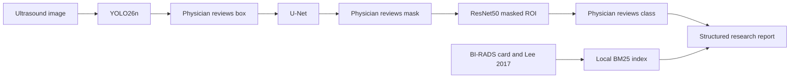

# Project audit

Date of this audit: 2026-11-08. The numbers below were read from the repository or recomputed by `python -m dataset.inspect`. They are not estimates.

Research use only. This system does not diagnose patients.

## Current architecture

The working system is a cascade on a local BUSI JPEG copy:

1. Folder labels and lesion masks are validated and split (`preprocessing/`, `dataset/`).
2. YOLO26n detects one tumor class (`yolo/`, weights `yolo26n.pt` and `checkpoints/yolo/busi_tumor/weights/best.pt`).
3. A U-Net with a ResNet34 encoder segments the cropped ROI (`unet/`, `checkpoints/unet/best_unet.pth`).
4. ResNet50 classifies a masked ROI as benign or malignant (`resnet/`, `checkpoints/resnet/best_resnet.pth`).
5. `inference/pipeline.py` chains the three checkpoints and accepts a manual box or mask.
6. `app.py` is a Streamlit review UI with accept/reject at detection, segmentation, and classification, plus a Stage 6 report panel.
7. `bus_research/` extracts PyRadiomics features, stores JSON records, retrieves references with BM25, and blocks BI-RADS training when labels are absent.
8. `reporting/` can draft a heuristic lexicon report. Its rule-based category is hidden unless `reporting.show_rule_category` is turned on. Those rules are not a trained BI-RADS model.

## What already works

- Preprocessing report at `results/preprocessing/report.json`: 647 images, 437 benign, 210 malignant, 665 masks, 0 critical validation errors, 1 cross-class exact duplicate.
- Saved train/val/test manifests and a YOLO dataset with one class, `tumor`. Label audit on 2026-11-08 found 461 / 104 / 100 boxes and 0 invalid boxes.
- Checkpoints exist and their state dicts load. U-Net config stored in the checkpoint: ResNet34 encoder, Dice weight 0.5, BCE weight 0.5. ResNet50 config: ImageNet initialization, 5 frozen epochs, then fine-tuning, label smoothing 0.05.
- Logged test metrics from 2026-10-07 are in `reports/logged_baseline_metrics.json`. They were not recomputed in this session.
- Streamlit review, Grad-CAM, radiomics records, and  the existing pytest suite.
- The master notebook `notebooks/Breast_CAD_Master.ipynb` (152 cells) already runs the older workflow.

## What is partial

- Physician review exists in Streamlit for the box, mask, class, and report. It did not have a single state machine that blocks a later stage after a rejection. `bus_research/review_workflow.py` and `api/` add that gate. The Streamlit app was left in place.
- RAG indexed the quick-reference card from a path under `dataset/BUSI_Jpeg/` and did not index Lee 2017. Config now points at `dataset/BIRADS Reference Card 1.pdf` and `dataset/usg-16034 (1).pdf`. Retrieval on 10 questions written from those PDFs is in `reports/rag_retrieval.json`.
- Shape, margin, and echo language in `reporting/lexicon.py` is a threshold rule on radiomic features. It is labeled heuristic in the app. It is not a descriptor model and it is not radiologist annotation.
- Segmentation metrics in the October logs are Dice, IoU, precision, recall, and specificity. HD95 and ASSD were not in that run. `evaluation/surface_distance.py` implements them in pixels and handles empty masks. They have not been run on the test set.
- The report language model in config is `Qwen/Qwen2.5-3B-Instruct`, not MedGemma. MedGemma 27B is refused on this machine. MedGemma 4B was not downloaded.

## What is incorrect or unsafe if read too literally

- The October test metrics are image-level. This copy has no patient identifier. The 2026-11-08 audit found 128 near-duplicate pairs at dHash Hamming 1–5, of which 63 cross the frozen split and 5 cross the benign/malignant folders. One exact duplicate pair, `benign (433)` and `malignant (145)`, is grouped into one split by the existing splitter. The high ResNet ROC-AUC must be read with that leakage in view. The split was not rebuilt, because a new split would make the saved checkpoints incomparable.
- `reporting/schema.py` still allows an LLM draft to contain a category. The new `StructuredStudyReport` does not. The new report path keeps `model_suggestion` null.
- `dataset/yolo_dataset/data.yaml` contains an absolute path from this machine.

## What is missing, and why it stays missing

| Request | Status | Reason |
| --- | --- | --- |
| Patient-level split | Not possible from these files | Filenames are dataset indices, not patient or accession ids |
| BI-RADS descriptor training | Not trained | No descriptor table. Inventing labels from benign/malignant would be false annotation |
| BI-RADS assessment model | Not trained | No category labels. Categories 0 and 6 are not image scores |
| Histopathology-confirmed target | Not in the repository | The only on-disk class label is the folder name |
| ResNet ROI vs full-image vs ROI+mask, and DenseNet / EfficientNet / ConvNeXt comparison | Code only | Running it would be a new experiment. No winner is declared |
| MedGemma 27B and 4B benchmark | Not run | 27B does not fit in 24 GiB. 4B is gated and was not downloaded. Qwen is not a silent substitute |
| HD95 / ASSD on the test set | Not run | Function is tested on synthetic masks only |
| Clinical validation | None | No external site, no reader study |

## What was reused

YOLO26n, the U-Net factory, ResNet50, the BUSI loaders, the Streamlit app, the radiomics store, and the BM25 index code. New modules call those pieces. Training entry points (`python train.py yolo|unet|resnet`) were not replaced.

## Dataset structure discovered on disk

- `dataset/BUSI_Jpeg/benign`, `benign_mask`, `malignant`, `malignant_mask`: 647 RGB PNGs, 8-bit, widths 190–1048, heights 324–719, 545 unique sizes. No DICOM and no spacing.
- 630 images have one mask, 16 have two, 1 has three. No image lacks a mask.
- `dataset/splits/{train,val,test}.json`: 452 / 98 / 97 images.
- `dataset/yolo_dataset`: class `tumor` only.
- References: `dataset/BIRADS Reference Card 1.pdf` (2 pages, ACR fifth-edition quick reference, card date 07.15) and `dataset/usg-16034 (1).pdf` (11 pages; Jiyon Lee, Ultrasonography 2017;36:71–81). A byte-identical card also sits at `dataset/BUSI_Jpeg/BIRADS Reference Card (1).pdf` and is not indexed twice.

Full tables: `reports/dataset_audit.md` and `reports/dataset_audit.json`. Class counts: `reports/figures/class_distribution.png`.

## Hardware seen on 2026-11-08

Apple Silicon, arm64, 10 CPU threads, 24 GiB RAM, PyTorch 2.12.1, CUDA unavailable, MPS available. The earlier sandbox check reported MPS unavailable; a run outside the sandbox saw MPS. MedGemma 27B is still out of range.

## Implementation plan from here

1. Keep the saved checkpoints as the baseline. Do not retrain them until a near-duplicate-aware split is chosen and the comparison is pre-registered.
2. If a radiologist labels descriptors and assessments on this set, or a new set with patient ids, train the multi-task heads and the assessment model only on those labels. Keep categories 0 and 6 out of the ordinal risk head.
3. Run the three ResNet input modes and the other backbones on that split. Select a model only after malignant sensitivity, specificity, ROC-AUC, PR-AUC, calibration, and a confidence interval are all on the same untouched test set.
4. Compute HD95 and ASSD on the existing U-Net test predictions before changing the segmentation loss.
5. Rebuild the RAG index after the config change (`bus_research.rag_eval.build_project_index`). The saved index under `results/rag/` predates the Lee 2017 source.
6. Use MedGemma 4B only after Hugging Face access is granted and a small grounded-report test is scored. Do not load 27B on this machine.

## Unresolved questions

- Are the near-duplicate frames repeat sweeps of one lesion, or coincidental looks? The files do not say. They still must not sit on both sides of a test split.
- Did the original BUSI release confirm every malignant label by biopsy? This repository does not contain that table, so the code treats the folder name as the label source.
- Should the frozen split be retired? Doing so invalidates the October metrics and the checkpoints. That decision is still open.
