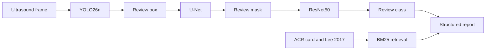

# Breast ultrasound research system

Research use only — not validated for autonomous clinical diagnosis or patient management.

A cascaded research pipeline for breast ultrasound: YOLO26n detection, U-Net segmentation, and ResNet50 benign/malignant classification, with physician approval before a structured report. BI-RADS wording comes from the ACR fifth-edition quick reference and from Lee 2017. The BUSI copy in this repository has no BI-RADS labels, so the system does not predict a BI-RADS category.

## Overview

The images are a local BUSI JPEG set: 647 RGB PNGs, 437 benign and 210 malignant, with 665 lesion masks. There is no patient identifier and no descriptor table. Details are in [docs/dataset.md](docs/dataset.md) and [reports/dataset_audit.md](reports/dataset_audit.md).

The cascade checkpoints were trained earlier. Their test logs from 2026-10-07 are stored in [reports/logged_baseline_metrics.json](reports/logged_baseline_metrics.json). Those numbers are image-level. 63 near-duplicate pairs cross that frozen split, so those figures are not a patient-level performance claim.

The current image-classification experiment is separate. It trains EfficientNet-B0 first, then DenseNet121, MobileNetV3-Small, and ResNet18 one at a time, on a near-duplicate-aware split. The run on 2026-11-08 selected DenseNet121 by validation ROC-AUC. Test labels were not used for that choice. See [reports/classification_evaluation.md](reports/classification_evaluation.md).

## Motivation

Breast ultrasound reporting uses a fixed lexicon. A detector, a segmenter, and a benign/malignant classifier answer different questions from a BI-RADS assessment. This repository keeps those questions apart and leaves the assessment to a qualified reviewer.

## Objectives

- Detect a lesion, segment it, and classify the masked ROI as benign or malignant.
- Show each output for review before the next stage uses it.
- Quote BI-RADS terms from the supplied documents, with page citations.
- Leave missing descriptors and the assessment null until a person enters them.
- Stay reproducible from a notebook, a CLI, Streamlit, or a local API.

## Architecture



More detail: [docs/architecture.md](docs/architecture.md).

## Workflow

1. Check image quality.
2. Detect. The reviewer accepts, rejects, edits, or marks the box uncertain.
3. Segment the approved ROI. The reviewer accepts, edits, or rejects the mask.
4. Classify the approved masked ROI. The reviewer accepts, corrects, or marks it uncertain.
5. Descriptors stay empty. Geometry from the mask is auxiliary and is not a lexicon term.
6. Only the reviewer enters BI-RADS 0–6.
7. The reviewer approves the report. The export keeps the audit log.

A rejected stage does not feed the next one (`bus_research/review_workflow.py`).

## Detection, segmentation, classification

| Stage | Code | Checkpoint |
| --- | --- | --- |
| YOLO26n, class `tumor` | `yolo/` | `checkpoints/yolo/busi_tumor/weights/best.pt` |
| U-Net, ResNet34 encoder, Dice+BCE | `unet/` | `checkpoints/unet/best_unet.pth` |
| ResNet50, masked ROI | `resnet/` | `checkpoints/resnet/best_resnet.pth` |

Logged test metrics, 2026-10-07, not recomputed later:

| Stage | Result |
| --- | --- |
| YOLO26n | Precision 0.884, recall 0.770, F1 0.823, mAP@0.50 0.734, mAP@0.50:0.95 0.545 |
| U-Net | Dice 0.936, IoU 0.882, precision 0.927, recall 0.949, specificity 0.918 |
| ResNet50, isolated, ground-truth ROI | Accuracy 0.93, malignant recall 0.806, ROC-AUC 0.984, PR-AUC 0.968 |
| Full cascade | Accuracy 0.830, F1 0.746, ROC-AUC 0.892, 9 missed detections, mean Dice 0.807 |

HD95 and ASSD were not part of that run. `evaluation/surface_distance.py` implements both in pixels.

`resnet/input_modes.py` defines four inputs: full frame, ROI, masked ROI, and ROI plus a mask channel. Only masked ROI has a cascade checkpoint. The October ResNet50 weights were not replaced.

The folder name is the classification label. It is not a BI-RADS category. See [docs/model_card.md](docs/model_card.md).

### Full-image classifiers, 2026-11-08

`classification/` trains on the whole letterboxed frame, not the masked ROI. Settings in `config.yaml`: 224 px, batch 8, at most 6 epochs, 1 frozen epoch, patience 2, class-weighted cross-entropy, seed 42. Split sizes: train 448 (304 benign / 144 malignant), validation 97 (68 / 29), test 91 (59 / 32). Five groups that mix both folder labels were held out. Near-duplicate pairs crossing the new splits: 0. There is still no patient identifier.

Validation chose the model. Test was scored afterwards.

| Model | Validation ROC-AUC | Validation malignant sensitivity | Epochs | Peak RSS |
| --- | --- | --- | --- | --- |
| EfficientNet-B0 | 0.948 | 0.828 | 5 | 1.05 GiB |
| DenseNet121 (selected) | 0.973 | 0.862 | 6 | 1.28 GiB |
| MobileNetV3-Small | 0.914 | 1.000 | 6 | 1.56 GiB |
| ResNet18 | 0.944 | 0.931 | 6 | 1.65 GiB |

DenseNet121 on the untouched test split, threshold 0.65 chosen on validation: malignant sensitivity 0.781, benign specificity 0.983, malignant precision 0.962, malignant F1 0.862, macro-F1 0.899, ROC-AUC 0.936, PR-AUC 0.919, Brier 0.086. Confusion matrix, rows true benign then malignant: [[58, 1], [7, 25]]. These are folder-label results on 91 images. They are not a clinical diagnosis.

EfficientNet-B0 remained the starting model. Its test sensitivity was 0.844, higher than the selected model's, but the selection rule did not look at the test set. Checkpoints are under `checkpoints/classification/`. The selected copy is `checkpoints/classification/selected/best.pt`.

## BI-RADS descriptors and assessment

The lexicon transcribed from the two PDFs is in [docs/birads_lexicon.md](docs/birads_lexicon.md).

Lee 2017, printed pages 79–80, quotes category 3 as >0% to ≤2%, 4A as >2% to ≤10%, 4B as >10% to ≤50%, 4C as >50% to <95%, and category 5 as ≥95%. Those sentences are reference text. A softmax probability is not passed through them.

Orientation is the long axis relative to the skin. A round mass is neither parallel nor not parallel. The geometry helper does not invent an orientation.

There is no descriptor model and no assessment model.

## Retrieval

Sources in `config.yaml`:

1. ACR quick reference, `dataset/BIRADS Reference Card 1.pdf` (primary).
2. Lee 2017, `dataset/usg-16034 (1).pdf` (primary, CC BY-NC). PDF page n is printed page n+70.
3. PyRadiomics docstrings and the project's own notes (secondary, labeled as such).

Chunking keeps the page and a section label. Ranking is BM25. On 10 questions written from phrases in those PDFs, measured 2026-11-08: recall@5 1.00, MRR 0.608, nDCG@5 0.706, precision@5 0.28. Precision is low because several of the five returned chunks are only related, not the defining sentence. This is a phrase test, not a radiologist relevance set. Numbers: `reports/rag_retrieval.json`.

## Language model

Reporting is off. `config.yaml` sets `reporting.llm.backend` to `off` and both model ids to null, so the app and the notebook do not download a language model.

`google/medgemma-27b-text-it` is refused on this machine. A 27B checkpoint does not fit 24 GB unified memory. `google/medgemma-1.5-4b-it` is also refused without download: the published shards are 4.96 GB and 3.64 GB, 8.60 GB together, above the 8 GB optional-checkpoint cap. The measured peak process budget is 18 GiB. See `utils/hardware.py` and [HARDWARE_AUDIT.md](HARDWARE_AUDIT.md).

The structured report builder does not call a language model. It copies approved fields and leaves the rest null.

## Physician review

Streamlit (`app.py`) reviews the box, mask, class, and an optional older report panel. The API (`api/main.py`) enforces the seven-stage order and requires `REVIEWER_TOKEN`.

Safety notes: [docs/clinical_safety.md](docs/clinical_safety.md).

## Installation

```bash
python3 -m venv venv
source venv/bin/activate
pip install -r requirements.txt
pip install -r requirements-research.txt
pip install -r requirements-reporting.txt   # local LLM and embeddings
pip install -r requirements-api.txt         # FastAPI
cp .env.example .env
```

Hardware used for the 2026-11-08 notebook run: Apple Silicon (arm64), 10 CPU threads, 24.00 GiB RAM, about 169 GiB free disk, PyTorch 2.12.1, MPS available, CUDA not available. Classifier training used MPS, batch size 8, and image size 224. Peak training RSS was 1.65 GiB. Do not load MedGemma 27B or MedGemma 1.5 4B here.

Hugging Face: a token is required only for gated models. This project does not download MedGemma.

## Configuration

`config.yaml` is the default. Override files in `configs/` are deep-merged. Paths, thresholds, batch size, and `device` (`null` for auto, or `cpu` / `mps` / `cuda`) live there.

## Notebook

The only project notebook is `notebooks/Breast_Ultrasound_AI_End_to_End.ipynb`. It is the entry point for YOLO26n detection, U-Net segmentation, ResNet50 classification, BI-RADS retrieval, and a local report draft.

Open it from the repository root:

```bash
source venv/bin/activate
jupyter lab notebooks/Breast_Ultrasound_AI_End_to_End.ipynb
```

Use Restart Kernel and Run All. `TRAIN_MODE` is false, so Run All loads the saved checkpoints and does not fine-tune. Set `IMAGE_PATH` to choose a different ultrasound PNG. Set `TRAIN_MODE = True` only when you intend to train. An approved report is written only after the review stages are approved; the default run saves `results/notebook_end_to_end/draft_report.json` and withholds the approved export.

The local generator is TinyLlama 1.1B, already stored on this machine. It is not a medical foundation model. MedGemma 27B and MedGemma 1.5 4B are refused and are not downloaded. If the language-model text is not valid report JSON, the notebook says so and does not present that text as the report.

## Training and inference

```bash
python train.py preprocess
python train.py yolo
python train.py unet
python train.py resnet
python evaluate.py yolo --weights checkpoints/yolo/busi_tumor/weights/best.pt
python evaluate.py unet --checkpoint checkpoints/unet/best_unet.pth
python evaluate.py resnet --checkpoint checkpoints/resnet/best_resnet.pth
python evaluate.py cascade
python inference.py --input path/to/image.png --output results/inference/
```

`python -m dataset.inspect` rewrites `reports/dataset_audit.md`.

## API and Streamlit

```bash
export REVIEWER_TOKEN=local-research-token
uvicorn api.main:app --reload
```

Open `http://127.0.0.1:8000/docs`. Review routes send header `x-reviewer-token`.

```bash
streamlit run app.py
```

The API keeps studies in memory. Restarting the process drops them. Do not send identified clinical images.

## Example report shape

Values below are the empty state, not a case result.

```json
{
  "study_id": "",
  "disclaimer": "Research use only — not validated for autonomous clinical diagnosis or patient management.",
  "detection": {"lesion_detected": null, "bounding_box": null, "confidence": null, "physician_review_status": "pending"},
  "segmentation": {"mask_reference": null, "confidence": null, "physician_review_status": "pending"},
  "classification": {"predicted_class": null, "probability": null, "physician_review_status": "pending"},
  "birads_descriptors": {"shape": null, "orientation": null, "margin": [], "echo_pattern": null},
  "birads_assessment": {"model_suggestion": null, "physician_final_assessment": null, "status": "pending"},
  "workflow": {"physician_approved": false, "audit_log": []}
}
```

## Tests

```bash
pytest tests/
```

`pytest tests/` covers the review gate, a fake-pipeline API study, surface distance, backbone shapes, and retrieval against the two PDFs. It does not retrain the classifiers.

Two cascade regression tests currently fail. On CPU, the saved YOLO boxes and predicted class still match `tests/fixtures/pipeline_regression.json`, but the malignant probability and the U-Net mask area differ from that fixture. The same mismatch happens with the original `config.yaml`. The October cascade weights were not changed, and the fixture was not rewritten.

## Limitations

- No patient identifier, no external test set, and no reader study. The new split blocks exact and near-duplicate leakage. It cannot block patient leakage.
- Near-duplicate frames still cross the older split used by the October cascade logs.
- The selected DenseNet121 test set has 32 malignant images. Seven of those were missed at the validation threshold. That is a research count, not a clinical sensitivity.
- Descriptors and BI-RADS categories are not predicted.
- Posterior features, echogenicity, and calcifications need the image and, for calcifications, mammographic correlation. A mask measurement is not those findings.
- The language-model report path in the older Stage 6 panel can still draft text when a reviewer asks for it. The new structured report does not.

## References

- Al-Dhabyani W, Gomaa M, Khaled H, Fahmy A. Dataset of breast ultrasound images. Data in Brief. 2020;28:104863. The folder labels in this copy are used as supplied. The paper's pathology process is not re-verified from files in this repository.
- American College of Radiology. ACR BI-RADS Atlas, 5th ed. Quick reference card, 07.15. https://www.acr.org/birads
- Lee J. Practical and illustrated summary of updated BI-RADS for ultrasonography. Ultrasonography. 2017;36(1):71-81. https://doi.org/10.14366/usg.16034
- van Griethuysen JJM, et al. Computational radiomics system to decode the radiographic phenotype. Cancer Research. 2017;77(21):e104-e107.

## Further work

- Expert descriptor and assessment labels, with categories 0 and 6 held out of any ordinal model.
- HD95 and ASSD on the current U-Net test predictions.
- Confidence intervals on the 91-image test split.
- A machine with a larger memory budget before any MedGemma checkpoint is considered. This laptop is outside that budget.

Audit narrative: [PROJECT_AUDIT.md](PROJECT_AUDIT.md). Session record: [ENGINEERING_REPORT.md](ENGINEERING_REPORT.md).
