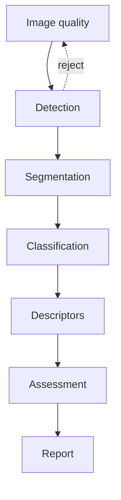

# Architecture

Research use only. This is a decision-support prototype. It does not finalize a diagnosis.

## Models that exist today

| Stage | Implementation | Checkpoint | Trained input |
| --- | --- | --- | --- |
| Detection | Ultralytics YOLO26n, one class `tumor` | `checkpoints/yolo/busi_tumor/weights/best.pt` | Full frame, 640 px, boxes derived from masks |
| Segmentation | `segmentation_models_pytorch` U-Net, ResNet34 encoder | `checkpoints/unet/best_unet.pth` | 256×256 ROI, 3 channels |
| Classification | torchvision ResNet50 | `checkpoints/resnet/best_resnet.pth` | 256×256 ROI with non-lesion pixels zeroed |

`inference/pipeline.py` loads all three. A caller can pass a manual box or mask. The Streamlit app (`app.py`) is the interactive reviewer. The FastAPI service (`api/main.py`) is a second, token-gated reviewer with an explicit stage order.

## What is intentionally not a model

- BI-RADS descriptors. No training labels exist. `bus_research/geometry.py` measures a mask and does not assign shape, margin, echo pattern, or orientation.
- BI-RADS assessment. `bus_research/birads.py` refuses to train without radiologist categories. Categories 0 and 6 are excluded from any future risk head. The API accepts a category only from the reviewer payload.
- The language model. It is not called by the new report builder. Config still names Qwen2.5-3B for the older Stage 6 path. MedGemma is selected only by changing the model id, and 27B is refused when RAM is under 48 GiB (`reporting/llm_selection.py`).

## Retrieval

`bus_research/rag.py` chunks the two supplied PDFs by page, keeps page number and a section label, and ranks chunks with BM25. Project notes and PyRadiomics docstrings remain secondary sources in `config.yaml`. Case JSON under `results/` is on the forbidden list.

## Review order

`image_quality → detection → segmentation → classification → descriptors → assessment → report`

A rejected or uncertain stage clears every later decision. Edited output also clears later stages so they cannot keep consuming the previous prediction.

